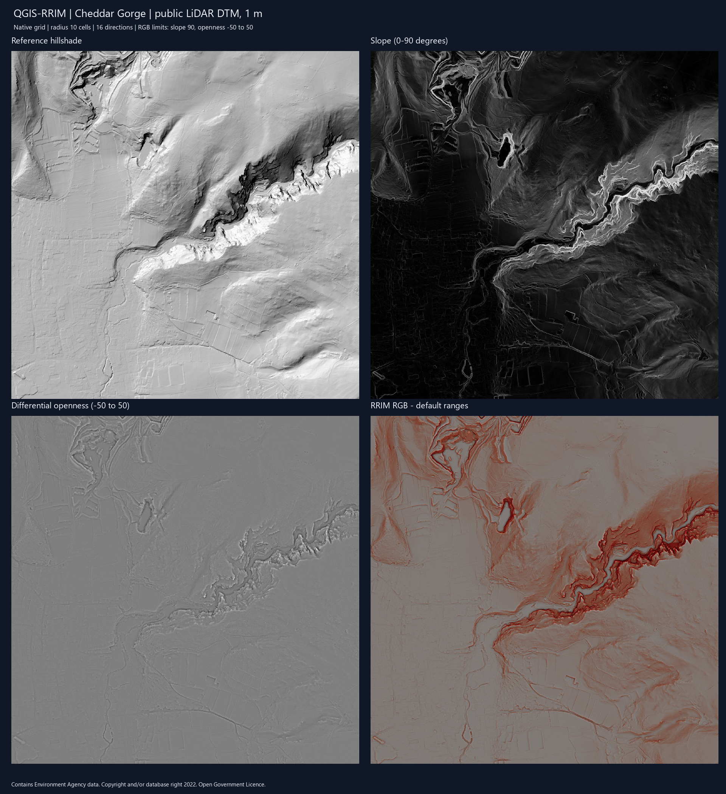

<a href="README.md">English</a> · <strong>Español</strong>

# QGIS-RRIM

**Mapas de relieve rojo — RRIM — desde Processing de QGIS.**

Calcula pendiente y apertura diferencial a partir de un DEM proyectado y
compón un GeoTIFF RGB georreferenciado con límites de visualización explícitos.

> RRIM resalta morfología; no clasifica automáticamente geoformas ni
> estructuras geológicas. Resolución, unidades verticales, radio y bordes
> condicionan la interpretación.

## Instalación

Los metadatos declaran QGIS 3.28–3.99; la validación local se ejecutó en 3.44.12.
No depende de Relief Visualization Toolbox.

1. Descarga el ZIP de la [última release](https://github.com/jordan-zav/QGIS-RRIM/releases/latest).
2. Abre Complementos → Administrar e instalar complementos → Instalar a partir de ZIP.
3. Selecciona el ZIP y activa QGIS-RRIM.

En desarrollo, copia o enlaza el repositorio como qgis_rrim dentro de
python/plugins del perfil activo y reinicia QGIS.

## Herramientas y uso

**RRIM Generator** genera pendiente en grados y apertura diferencial, definida
como (apertura positiva − apertura negativa) / 2. Puede guardar copias de
presentación: pendiente de 0–90° con rampa roja y mezcla Multiply, y apertura
diferencial limitada a −50–50.

La versión 1.1.0 utiliza **10 celdas de radio y 16 direcciones**, valores fijos.
Su distancia física depende del tamaño de píxel.

**RRIM RGB Composer** combina pendiente y apertura ya calculadas. Permite
definir pendiente máxima, apertura mínima/máxima y ruta del GeoTIFF. Requiere
igual CRS, extensión, dimensiones y malla en las dos entradas; no remuestrea.

1. Carga un DEM monobanda proyectado y revisa unidades horizontales y verticales.
2. Abre Caja de herramientas de Processing → QGIS-RRIM → RRIM Generator.
3. Guarda las salidas y solicita copias normalizadas si las necesitas.
4. Ejecuta RRIM RGB Composer con límites revisados.
5. Compara el RGB a varias escalas con DEM, curvas, sombreado e imágenes.

Los algoritmos también se pueden usar por lotes y en el Modelador de QGIS.

## Calidad de datos

Una máscara interna conserva los píxeles inválidos; el negro válido no se
convierte en NoData. Se conservan los píxeles rectangulares. Generador y
compositor requieren mallas orientadas al norte: transforma antes entradas
rotadas o cizalladas. El núcleo de apertura utiliza la transformación afín
completa para medir distancias.

Las salidas deben tener nombres distintos del DEM, de los archivos que este
referencia mediante VRT y de las demás salidas. Cada archivo se prepara antes
de reemplazar su destino, conservando el anterior si esa escritura falla o se
cancela. Los productos ya terminados del generador no se revierten si se cancela
una etapa posterior. Si un destino tiene máscaras, pirámides o archivos PAM
externos, elija otro nombre para evitar reutilizar auxiliares antiguos.

Los límites NoData reducen direcciones disponibles; las celdas sin muestras
válidas quedan como NoData. Los bordes externos usan relleno reflejado.
Remuestrear no crea detalle nuevo y el contraste RRIM no es una clase física.

## Método y pruebas

Basado en Chiba, Kaneta y Suzuki (2008), Red Relief Image Map: New Visualization
Method for Three Dimensional Data, ISPRS XXXVII-B2, 1071–1076.
[Artículo original](https://www.isprs.org/proceedings/XXXVII/congress/2_pdf/11_ThS-6/08.pdf).

~~~powershell
python -m pytest -q
~~~

Las pruebas independientes de QGIS contrastan terrenos planos, planos inclinados,
una implementación de horizonte de referencia y la validación de rutas.
Ejecuta además lo siguiente con el Python incluido en QGIS y una carpeta de
salida nueva para cada ejecución de regresiones:

~~~powershell
python tests/qgis_integration.py
python tests/qgis_regressions.py --output RUTA_NUEVA_DE_PRUEBAS
~~~

La revisión registró 19 pruebas Python y 20 regresiones con QGIS/GDAL aprobadas,
además del flujo de integración. Son comprobaciones automatizadas; antes de
publicar también debe revisarse la interacción con los diálogos de Processing.

## Estado y organización

Esta entrega usa 1.1.0 por petición del mantenedor, tras revisar la fuente que
declaraba 2.2.0. Se conservan los tags históricos, incluido 2.1.0; la numeración
inferior es intencional. Quedan pendientes
parámetros de radio/direcciones configurables. Las pruebas nativas de seguridad
de archivos, cancelación, ciclo de vida y estilos están en tests/qgis_regressions.py.
Consulte la [revisión de código y validación](docs/CODE_REVIEW_20261029.md).
rrim_openness.py contiene el motor por bloques;
rrim_algorithm.py y rrim_rgb_composer.py implementan los dos algoritmos;
rrim_provider.py registra el proveedor y metadata.txt describe el complemento.

## Ejemplo con LiDAR público

Validado con un DTM de la Environment Agency de Cheddar Gorge: 2048 × 2048
píxeles de 1 m, EPSG:27700. En el equipo de revisión, el generador tardó unos
27 segundos y la exportación RGB unos 0,5 segundos. Son tiempos de esta muestra,
no una garantía de rendimiento. Se conservaron la malla y el DEM original.

El [informe de validación LiDAR](docs/LIDAR_VALIDATION_1_1_0.md) incluye la fuente,
los parámetros, las observaciones visuales y cómo repetir la prueba.

## Licencia y contacto

[GNU GPL v3](LICENSE). Jordan Zavaleta — GisGeo Dev.
[Correo](mailto:jordanzav@gisgeo.dev) · [Sitio web](https://gisgeo.dev).

[Documentaci?n y empaquetado de versiones](docs/README.md)
