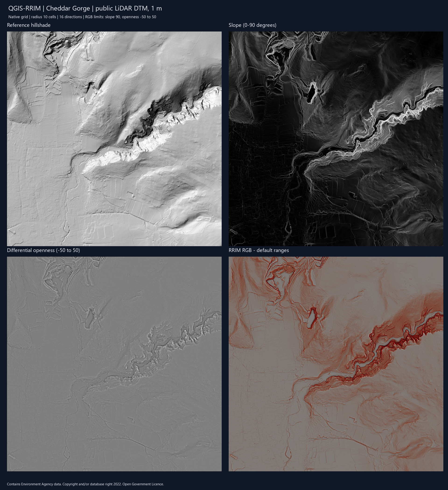

<strong>English</strong> · <a href="README.es.md">Español</a>

  

# QGIS-RRIM

**Red Relief Image Map generation directly in QGIS Processing**

Derive slope and differential openness from a projected DEM, apply consistent
display ranges and export a georeferenced RRIM RGB GeoTIFF.

> [!IMPORTANT]
> QGIS-RRIM is a terrain-visualization tool. RRIM enhances morphology but does
> not classify landforms or geological structures. Pixel size, vertical units,
> openness radius and edge effects must be considered during interpretation.

## Workflow at a glance

~~~text
Single-band DEM in a projected CRS
    ├──► Slope (degrees)
    └──► Positive and negative openness
                    │
                    ▼
         Differential openness = (positive - negative) / 2

Slope + differential openness
    ├──► Optional display-ready normalized copies
    └──► RGB Composer: red slope × grayscale openness
                    │
                    ▼
              RGB GeoTIFF
~~~

## Processing tools

### RRIM Generator

Produces the geomorphometric inputs used by the composition:

| Output | Meaning |
| --- | --- |
| Slope | QGIS native slope in degrees |
| Differential openness | Half the difference between positive and negative openness |
| Normalized slope | Optional 0–90° display copy with red ramp and Multiply blending |
| Normalized differential openness | Optional display copy clamped to -50–50 |

The internal horizon implementation currently uses a radius of **10 cells** and
**16 directions**. These values are fixed in version 1.1.0 and therefore
represent different physical distances when DEM pixel size changes.

### RRIM RGB Composer

Combines existing slope and differential-openness rasters into one packed RGB
GeoTIFF. The operator controls:

- maximum displayed slope;
- minimum differential openness;
- maximum differential openness; and
- output GeoTIFF path.

Both inputs must have the same raster dimensions, extent and CRS.
RGB colors are computed per pixel without resampling. An internal GeoTIFF
mask preserves invalid pixels from either input; valid black remains valid.
Rectangular pixels retain their original grid in all outputs. The generator
and RGB composer require north-up grids; warp rotated or sheared inputs first.
The openness kernel itself measures distances using the full affine transform.

Output filenames must differ from the DEM, its referenced VRT files and each
other. Each raster is staged before replacing a destination, preserving the
previous file if its writing fails or is canceled. A generator run publishes
its products separately; already completed products are not rolled back if a
later stage is canceled. If a destination has external masks, overviews or PAM
sidecars, choose a new filename to avoid reusing stale auxiliary data.

## Requirements

- QGIS 3.28–3.99 as declared in metadata; validated locally on 3.44.12;
- a valid single-band DEM;
- projected CRS;
- horizontal and elevation units that are mutually consistent; and
- enough memory and temporary disk space for the DEM and openness halo blocks.

The plugin computes openness internally and does not require the Relief
Visualization Toolbox plugin.

## Installation

### From a release ZIP

1. download the ZIP from the [latest release](https://github.com/jordan-zav/QGIS-RRIM/releases/latest);
2. open **Plugins → Manage and Install Plugins** in QGIS;
3. choose **Install from ZIP**; and
4. select the downloaded archive and enable QGIS-RRIM.

### Development checkout

Copy or link the repository as <code>qgis_rrim</code> inside the active QGIS profile's
<code>python/plugins</code> directory, then restart QGIS and enable the plugin.

## Use in QGIS

1. load a projected DEM and confirm its pixel/elevation units;
2. open **Processing Toolbox → QGIS-RRIM → RRIM Generator**;
3. save slope and differential openness outputs;
4. optionally request normalized display copies;
5. run **RRIM RGB Composer** with reviewed display limits; and
6. inspect the RGB output at several scales and alongside the original DEM.

Because both tools are QGIS Processing algorithms, they can also be used in
batch processing and Model Designer workflows.

## Interpretation and quality control

- The 10-cell radius must be converted to a physical distance using pixel size.
- NoData boundaries and raster edges reduce the available horizon neighborhood.
- Openness averages only directions with valid samples; cells without any
  valid horizon samples remain NoData. Outer edges use reflected padding.
- Resampling a DEM does not create new topographic detail.
- Slope and openness depend on DEM noise, smoothing and vertical/horizontal units.
- RRIM contrast is a visualization choice, not a quantitative terrain class.
- Compare features against contours, hillshade, imagery and field/geological data.

## Method reference

The implementation follows the RRIM concept described by:

> Chiba, T., Kaneta, S. and Suzuki, Y. (2008). *Red Relief Image Map: New
> Visualization Method for Three Dimensional Data*. The International Archives
> of the Photogrammetry, Remote Sensing and Spatial Information Sciences,
> XXXVII-B2, 1071–1076.

[Read the original ISPRS paper](https://www.isprs.org/proceedings/XXXVII/congress/2_pdf/11_ThS-6/08.pdf).

## Development and verification

The numerical openness tests are independent of QGIS and can be executed with:

~~~powershell
python -m pytest -q
~~~

They check flat terrain, uniform planes, a reference horizon calculation and
path validation. Run the following separately with the Python supplied by QGIS;
use a new output directory for each regression run:

~~~powershell
python tests/qgis_integration.py
python tests/qgis_regressions.py --output PATH_TO_NEW_TEST_DIRECTORY
~~~

The review recorded 19 Python tests and 20 native QGIS/GDAL regression cases
passing, plus the integration workflow. These automated checks do not replace
an interactive review of the Processing dialogs before a release.

## Repository map

| Path | Contents |
| --- | --- |
| <code>qgis_rrim.py</code> | Plugin lifecycle and provider registration |
| <code>rrim_provider.py</code> | QGIS Processing provider |
| <code>rrim_algorithm.py</code> | RRIM Generator workflow |
| <code>rrim_openness.py</code> | Block-based positive/negative openness engine |
| <code>rrim_rgb_composer.py</code> | RGB composition and GeoTIFF export |
| <code>tests</code> | Numerical, path-safety and native QGIS/GDAL tests |
| <code>metadata.txt</code> | QGIS Plugin Repository metadata |

## Project status

This delivery uses version 1.1.0 at the maintainer's request, following the review
of the source previously labeled 2.2.0. Historical tags, including 2.1.0, are
retained; the lower number is intentional. The
internal openness implementation removes the former runtime dependency on RVT.
Configurable radius/direction parameters remain pending. Raster safety,
cancellation, provider lifecycle and output styling now have native QGIS
regressions in tests/qgis_regressions.py. See the
[code review and validation](docs/CODE_REVIEW_20261029.md).

## Public LiDAR example

Validated on a 2048 × 2048 pixel, 1 m Environment Agency DTM of Cheddar Gorge
in EPSG:27700. The generator took about 27 seconds on the review machine and
RGB export about 0.5 seconds. These are observations for this sample, not a
performance guarantee. The source grid and DEM were preserved.

See the [LiDAR validation report](docs/LIDAR_VALIDATION_1_1_0.md) for source,
parameters, visual findings and reproduction instructions.

## License and contact

QGIS-RRIM is distributed under the [GNU General Public License v3.0](LICENSE).

Jordan Zavaleta — GisGeo Dev 
[jordanzav@gisgeo.dev](mailto:jordanzav@gisgeo.dev) · [gisgeo.dev](https://gisgeo.dev)

[Documentation and release packaging](docs/README.md)
