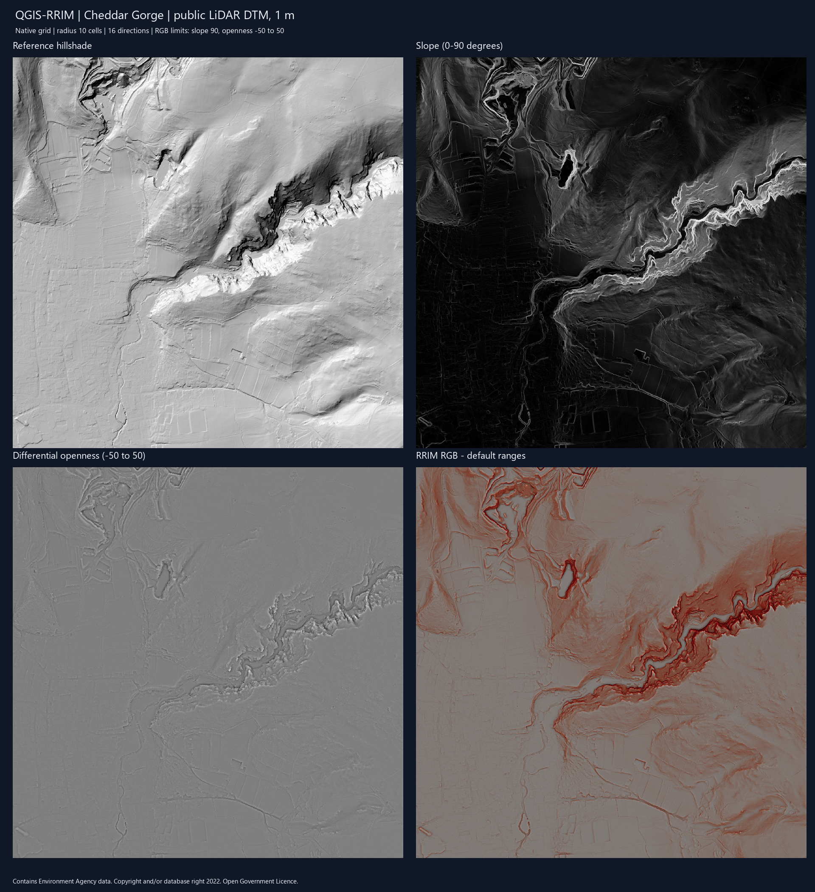
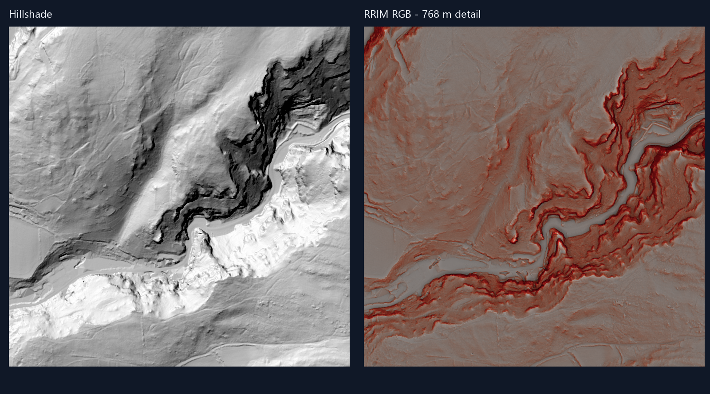

# QGIS-RRIM 1.1.0 — public LiDAR validation

29 October 2026. This delivery uses 1.1.0 at the maintainer's request. Earlier
GitHub tags remain intact; the reviewed source previously declared 2.2.0.

## Input and provenance

- [Environment Agency LIDAR Composite DTM, 1 m, 2022](https://www.data.gov.uk/dataset/01b3ee39-da3f-47b6-83da-dc98e73a461f/lidar-composite-digital-terrain-model-dtm-1m).
- Public WCS elevation coverage, not the hillshade coverage or a map image.
- Cheddar Gorge, England. EPSG:27700; horizontal and elevation units in metres.
- Bounds: E 345500–347548; N 153000–155048. Native 1 m grid, 2048 × 2048 cells.
- Downloaded GeoTIFF SHA256: ed18951a257d2574bbc56fd7dcc967485b1876b0d973e4cd4ee992a318875c74.
- Contains Environment Agency data, copyright and/or database right 2022.
  Supplied under the Open Government Licence.

The publisher describes this as a composite derived from LiDAR surveys, including
resampling during its production. The test applies no additional resampling.

Download request:

~~~text
https://environment.data.gov.uk/spatialdata/lidar-composite-digital-terrain-model-dtm-1m/wcs?SERVICE=WCS&VERSION=2.0.1&REQUEST=GetCoverage&COVERAGEID=13787b9a-26a4-4775-8523-806d13af58fc__Lidar_Composite_Elevation_DTM_1m&SUBSET=E(345500,347548)&SUBSET=N(153000,155048)&FORMAT=image/tiff
~~~

## Processing and numerical checks

Executed both registered Processing algorithms in QGIS 3.44.12-Solothurn,
Qt 5.15.13, GDAL 3.13.1, Python 3.12.13, Windows. Automated rendering and dialogs
used an isolated profile; the normal QGIS profile was not modified.

- RRIM Generator: fixed 10-cell radius, 16 directions, slope Z factor 1;
  normalized copies enabled.
- RRIM RGB Composer: slope maximum 90°, differential-openness range −50 to 50.
- Independent reference image: GDAL hillshade from the same DTM.
- All 4,194,304 pixels were valid in each output. Output size, affine grid and
  CRS matched the input. All valid values were finite. Input SHA256 unchanged.
- Slope range: 0–86.7993°. Differential openness: −53.0160–53.5823°.
  Its normalized copy correctly clips to −50–50.
- First run: generator 27.04 s; RGB export 0.52 s. Sample-specific observations,
  without a general speed or memory guarantee.
- Repeated the complete workflow with the plugin extracted from the release ZIP:
  generator 16.53 s and RGB 0.54 s. All five output GeoTIFF SHA256 hashes matched
  the first run exactly. The input remained unchanged.

## Visual inspection

Inspected QGIS-rendered full-area and 768 m detail images against the reference
hillshade. Gorge walls, slope breaks, small channels and field-boundary relief
remain spatially consistent. No visible 512-cell block seams, striping, blank
areas or grid displacement were found in these views. Steep walls receive the
strongest red tones. Gentle terrain is subdued with the default display ranges;
the composer allows narrower ranges when the operator needs stronger contrast.

These findings apply to this sample and these views, and do not validate a
geological interpretation or all possible DEMs. Terrain detail and artifacts
already in the source DTM remain visible. Openness uses reflected outer borders.

Both Processing dialogs were instantiated and captured with their parameters
and help visible. An initial offscreen font-discovery problem was resolved by
explicitly loading the system font in the test harness; plugin fonts were not
changed. Dialog inspection was automated, not a manual click-through of QGIS.

## Reproduction

Download the coverage to an external data folder. From the repository, with the
Python bundled with QGIS and a new output directory:

~~~text
python tests/qgis_lidar_review.py --dem PATH_TO_DTM.tif --output NEW_OUTPUT_DIRECTORY
~~~

This writes the rasters, a QGIS project, results.json, comparison/detail images
and Processing dialog captures. Use --package-root PATH_TO_EXTRACTED_PLUGIN
to test an extracted release package. The DTM, profile/authentication directories
and processing outputs are not included in the plugin ZIP.

For the broader regression checks, see the
[code review](CODE_REVIEW_20261029.md): 19 Python tests, 20 native QGIS/GDAL
regressions, original integration workflow, selected Ruff rules and Bandit.
